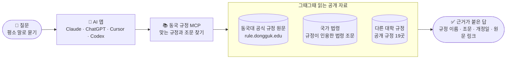

<h1 align="center">동국 규정 MCP</h1>

<p align="center">
  <b>동국대 규정을 AI에게 물으면, 공식 원문에서 찾은 조문과 링크를 붙여 답합니다.</b><br>
  Claude·ChatGPT·Cursor·Codex 같은 AI 앱에 주소 한 줄만 더하면 됩니다. 설치도 로그인도 없습니다.
</p>

<p align="center">
  <a href="docs/assets/usage-demo.mp4"></a>
  <br><sub>하이라이트(소리 없음)입니다. <a href="docs/assets/usage-demo.mp4"><b>▶ 내레이션이 있는 전체 영상(MP4, 약 1분 30초: 타대학 비교·상위 법령 조회 포함)</b></a> · 앱 화면은 예시이며 화면 속 규정·법령 내용은 공용 서버와 국가법령 실제 조회 결과(2026-11-26)입니다.</sub>
</p>

<p align="center">
  <a href="https://github.com/buenosiempre-cmd/dongguk-rule-mcp/releases/tag/v0.15.15"></a>
  <a href="LICENSE"></a>
  <a href="https://github.com/buenosiempre-cmd/dongguk-rule-mcp/actions/workflows/ci.yml"></a>
</p>

> 동국대학교의 공식 서비스가 아닌 개인 운영 도구입니다. 공개 규정 원문([rule.dongguk.edu](https://rule.dongguk.edu/))을 조회해 전달하며, 최종 판단은 공식 원문과 소관 부서 해석을 따르세요.  
> <em>Read-only MCP for Dongguk University regulations. Not an official university service.</em>

## 왜 써야 하나요

같은 질문 다섯 개를 세 가지 방법으로 해 봤습니다. 정답은 미리 원문에서 확인해 둔 것입니다(2026-11-26 측정).

| | 공식 규정 사이트 검색 | AI에 그냥 묻기 | AI + 동국 규정 MCP |
|---|:---:|:---:|:---:|
| 질문을 문장 그대로 넣으면 | 5개 모두 결과 0건 | 5개 모두 "확인하지 못했다" | 5개 모두 답함 |
| **정답** | 직접 원문을 열어 찾아야 함 | **0 / 5** | **5 / 5** |
| 근거 조문과 원문 링크 | 낱말로 다시 찾으면 규정 목록까지 | 없음 | 5개 모두 있음 |
| 걸린 시간 | 낱말 본문 검색 응답 약 10~15초, 그다음 원문 읽기 | 6~10초 (답은 없음) | 10~20초 |

- 공식 사이트 검색은 **규정 이름이나 낱말**로 찾는 방식입니다. 이번 다섯 질문을 문장 그대로 넣었을 때는 결과가 없었고, 낱말로 찾아도 금액과 일수는 원문을 열어 직접 읽어야 했습니다.
- 도구와 웹 검색을 끈 AI는 **학교 규정 원문을 볼 수 없었습니다.** 측정한 AI는 금액과 일수를 지어내지는 않았지만, 다섯 번 모두 "규정 원문을 확인하지 못했다"며 직접 찾아보라고 답했습니다.
- 동국 규정 MCP를 연결하면 AI가 **공식 원문을 그때 읽고** 답합니다. 이번 다섯 답에는 모두 규정 이름·조문과 원문 링크가 붙어 있었습니다. 링크를 눌러 바로 대조할 수 있습니다.

<details>
<summary>측정 방법과 한계</summary>

- **질문 5개:** 팀원 국내 출장 숙박비·식비·일비(「여비규정」 별표 1), 본인 결혼 경조휴가(「취업규칙」 제42조), 5년 근속 연가(「취업규칙」 제35조). 정답은 120,000원, 36,000원, 20,000원, 7일, 17일입니다.
- **공식 사이트 검색:** rule.dongguk.edu 검색에 질문 문장과 낱말 하나(숙박비·식비·일비·경조휴가·연가)를 각각 넣었습니다. 규정명 검색과 본문 검색을 모두 했습니다.
- **AI에 그냥 묻기:** Claude(Sonnet 모델)에 도구와 웹 검색을 모두 끄고 같은 질문을 했습니다. 근로기준법 같은 일반 기준을 참고로 덧붙인 답은 있었지만, 동국대 규정이라고 답한 것은 없어 정답으로 세지 않았습니다.
- **AI + 동국 규정 MCP:** 같은 모델에 공용 서버(v0.15.10)만 연결하고 같은 질문을 했습니다. 걸린 시간은 명령을 시작한 뒤 답이 끝날 때까지입니다(프로그램 시작 시간 포함). 같은 질문을 서버에 직접 두 차례씩 보냈을 때 응답은 약 0.2~2.3초였습니다. Opus 모델로 바꿔도 5개 모두 정답이었고 약 14.0~18.5초가 걸렸습니다.
- 정답을 아는 질문 5개로 한 작은 측정입니다. 전체 정확도를 뜻하지 않으며, 다른 AI 앱이나 웹 검색을 켠 AI는 재지 않았습니다.

</details>

## 한눈에 보기

| 규정 **513개** | 기능 **15가지** | 원문 대조 **누락 0** | 다른 대학 **19곳** |
|:---:|:---:|:---:|:---:|
| 동국대 현행 규정 전체를 찾아볼 수 있게 준비해 둡니다 | 찾기, 전문 보기, 개정 이력, 인용 점검, 근거 법령, 타대학 비교 | 규정 4개를 원본 한글 파일과 따로 대조했을 때 표 칸 2,428개·문단 700개 누락 0 | 같은 주제의 조문을 나란히 놓고 봅니다(한 번에 5곳까지) |

<sub>513개·15가지는 공용 서버가 2026-11-26에 알려 준 값입니다. 원문 대조는 규정 4개(여비·재무회계·법인카드·위임전결)를 v0.15.7에서 점검한 결과입니다.</sub>

**속도:** 위 질문 5개에서 서버가 조문을 찾아 돌려주는 데 0.2~2.3초가 걸렸습니다. 이전 점검(v0.15.7)에서는 자주 쓰는 조회 13종의 중간값이 0.30~1.08초였고, 동시에 10건을 보내도 모두 답했습니다. 처음 찾는 규정은 원문을 새로 읽느라 몇 초 더 걸릴 수 있습니다.

## 어떻게 동작하나요



1. **평소 말로 묻습니다.** "국내 출장 숙박비 기준 찾아줘"처럼 물으면 됩니다. 기능 이름을 외울 필요가 없습니다.
2. **AI 앱이 동국 규정 MCP를 부릅니다.** MCP는 AI 앱이 바깥 자료를 읽게 해 주는 연결 방식입니다.
3. **공식 원문을 그때 읽습니다.** 누구나 볼 수 있는 공개 규정만 읽습니다. 필요하면 규정이 인용한 국가 법령과 다른 대학의 공개 규정도 함께 봅니다.
4. **근거를 붙여 답합니다.** 규정 이름, 조문이나 별표, 개정일, 원문 링크가 함께 옵니다.

읽기만 합니다. 신고·지급·결재·발송은 하지 않습니다.

## 이런 걸 물어볼 수 있어요

| 하고 싶은 일 | 이렇게 물어보세요 |
|---|---|
| 규정에서 기준 찾기 | 여비규정에서 국내 출장 숙박비 기준을 찾아줘 |
| 금액표·별표 보기 | 위임전결규정 별표에서 물품 구매 전결 기준을 보여줘 |
| 규정 전체나 목차 보기 | 학칙 목차를 보여줘 |
| 언제 바뀌었는지 보기 | 여비규정이 언제 개정됐고, 직전 개정에서 뭐가 달라졌어? |
| 지난 일의 기준 찾기 | 2025년 3월 15일 출장에는 어느 여비규정을 봐야 해? |
| 문서에 쓴 조문 확인 | 이 기안문에 인용한 조문이 실제로 있는지 확인해줘 |
| 근거 법령 점검 | 이 규정이 근거로 든 법령이 바뀌었는지 봐줘 |
| 다른 대학과 비교 | 겸직 허가 기준을 연세대·한양대 규정과 나란히 보여줘 |

실제 답은 이런 모습입니다. 2026-11-26에 Claude(Sonnet)에 공용 서버를 연결해 받은 답의 앞부분입니다.

> **질문:** 동국대학교 직원이 5년 근속하면 연가는 1년에 며칠이야?
>
> **5년 근속 직원의 연가는 1년에 17일**입니다.
>
> 근거는 동국대학교 「취업규칙」(2026.04.29. 개정) **제35조(연가)**입니다. 연가는 재직년수에 따라 15일에서 25일까지입니다.
>
> | 재직년수 | 1~2년 | 3~4년 | **5~6년** | 7~8년 | 9~10년 | … | 21년 이상 |
> |---|---|---|---|---|---|---|---|
> | 연가일수 | 15일 | 16일 | **17일** | 18일 | 19일 | … | 25일 |
>
> (적용 대상 안내 생략)
>
> 원문: [취업규칙](https://rule.dongguk.edu/lmxsrv/law/lawFullView.srv?SEQ=127&SEQ_HISTORY=3619)

<details>
<summary>기능 15가지 전체 보기</summary>

기능은 AI 앱이 알아서 고릅니다. 15개 모두 읽기 전용입니다.

| 기능 이름 | 하는 일 | 이렇게 물으면 씁니다 |
|---|---|---|
| `lookup_dongguk_rule` | 질문에 맞는 규정을 찾아 관련 조문과 별표를 보여 줍니다. 대부분의 질문은 여기서 시작합니다 | 여비규정에서 국내 출장 숙박비 기준 찾아줘 |
| `search_rule` | 규정 이름이나 내용으로 후보 목록을 보여 줍니다 | 장학금과 관련된 규정이 뭐가 있어? |
| `get_rule_content` | 이미 고른 규정에서 특정 조나 장을 보여 줍니다 | 여비규정 제5조 보여줘 |
| `get_rule_full_text` | 규정 하나를 부칙·별표·서식까지 처음부터 끝까지 보여 줍니다 | 위임전결규정 전문을 보여줘 |
| `get_rule_toc` | 규정의 목차를 보여 줍니다 | 학칙 목차 보여줘 |
| `list_rule_history` | 규정이 언제 개정됐는지 이력을 보여 줍니다 | 여비규정이 언제 개정됐어? |
| `applicable_rule` | 특정 날짜 기준으로 어느 개정본이 후보인지 찾습니다 | 2025년 3월 15일 출장에는 어느 여비규정을 봐야 해? |
| `compare_rule_versions` | 두 개정본을 비교해 바뀐 조문과 별표를 보여 줍니다 | 여비규정이 직전 개정에서 뭐가 달라졌어? |
| `verify_rule_citations` | 문장에 적은 규정명과 조문이 실제로 있는지 확인합니다 | 이 기안문에 인용한 조문이 실제 있는지 확인해줘 |
| `search_rule_deep` | 여러 규정의 본문을 한꺼번에 검색합니다 | '겸직'이 나오는 규정을 모두 찾아줘 |
| `check_rule_updates` | 여러 규정이 기준일 이후 개정됐는지 한 번에 점검합니다 | 여비규정과 위임전결규정이 지난달 이후 개정됐어? |
| `get_rule_references` | 규정이 인용한 다른 교내 규정·국가 법령과, 이 규정을 인용한 규정을 찾습니다 | 여비규정이 인용하는 법령과 그 조문을 보여줘 |
| `get_rule_upper_laws` | 규정이 근거로 든 법령이 지금도 그대로인지 점검합니다 | 이 규정이 근거로 든 법령이 바뀌었는지 봐줘 |
| `compare_university_rules` | 같은 주제의 조문을 다른 대학(한 번에 최대 5곳) 규정과 나란히 보여 줍니다 | 겸직 허가 기준을 고려대·연세대와 나란히 보여줘 |
| `get_service_info` | 연결 상태와 버전을 알려 줍니다 | 동국 규정 MCP 연결됐는지 확인해줘 |

상위 법령·인용 관계 조회는 `병역법에 의한…`처럼 낫표와 조문 번호가 없는 법명도 공식 명칭과 대조합니다. 새로 찾은 명칭은 본문 요청을 끈 경우에도 대조하며(최대 8개·서버 호출 8회·총 6초), 대조에 성공한 것만 국가 법령 목록에 넣습니다. 연결 꺼짐·실패·미확인 표현은 원문 위치와 함께 `unverifiedLawMentions` 및 “법령명 확인 필요”에 남기고 근거 상태를 `partial`로 표시합니다. 이름 확인은 본문 조회나 해당 사건 적용의 확인이 아닙니다. 두 도구는 요청당 법령 서버 호출을 합계 32회까지 허용하며, 축약 검색·429 재시도도 한도에 포함합니다. 한도 초과는 `LEGAL_CALL_LIMIT`로 남깁니다. 모든 검색에서 명시적 `NOT_FOUND`가 반환된 이름만 별도 60초 캐시에 보관하고, 장애·시간초과·유사 이름 불일치·한도 초과는 보관하지 않습니다. 캐시가 켜져 있으면 같은 캐시 범위의 같은 이름에 대한 동시 확인을 합칩니다. 캐시 끄기(`DONGGUK_MCP_NO_CACHE=1`)는 이 보관과 호출 합치기도 끕니다. `맞춤법`·`수행법` 등 보통명사는 새 후보와 확인 필요 경고에서 제외하지만, 법률 약칭·불명확한 법명은 확인 필요로 유지합니다.

일반 HTML 규정 비교(서강·이화·서울대·연세)는 기존 본문 파싱·발췌·시행일을 유지합니다. 본칙 조문 번호의 누락·역행·중복이나 독립 부속 표제가 있으면 `articleBoundaryReview`와 **조문 경계 확인 필요** 안내를 표시합니다. 번호 순서만으로 실제 조문과 문장 속 참조를 확정할 수 없으므로 자동으로 조문을 합치거나 자르지 않습니다. 가지조문 순서도 점검하되, 경고가 없다고 경계를 검증한 것은 아닙니다. 참조가 별도 조문으로 표시되거나 별표 조문이 섞이는 기존 오류는 남을 수 있습니다. 조문 번호·본문 귀속·별표 여부는 원문에서 확인하세요.

이화여대 비교에서 `휴학·복학·재입학·전과·졸업·수료·학점·수강신청·제적·자퇴`는 **규정 제목 후보가 0건일 때만** 학부 학칙·학칙시행세칙을 최대 2개 읽습니다. 제목 후보가 하나라도 있으면 기존 제목 조회·발췌·응답을 그대로 사용하며, 본문 조회가 실패하거나 주제 조문을 못 찾더라도 학칙을 보충하지 않습니다. 제목 0건의 보충 경로에만 어절·지원하는 조사/활용형·학사 복합어 필터를 적용하여 `전과정` 속 `전과` 같은 부분 일치를 제외합니다. 이 보충 경로는 지원하지 않는 어형을 놓칠 수 있습니다. 후보 선정·본문 조회 시도·읽음 수를 구분하며 대학원·다른 기관 주제로 확대하지 않습니다. 제목 0건 응답은 탐색 범위와 학칙 후보 사용 여부를 표시합니다. 전체 규정 전문을 검색한 결과는 아닙니다.

법인카드·수의계약·구매·회의비·예산 전용·증빙 비교는 이미 읽은 조문의 핵심어 위치와 **질문 전체 검색어(사용·제한 등)**를 함께 평가합니다. 제목에 주제명만 있다고 무조건 앞에 두지 않습니다. 기존 제목 가산 한도 2점 안에서 제목에 일치한 검색어의 비율을 반영하며, PDF 첫 줄에 붙은 본문은 제목으로 계산하지 않습니다. `articles[].topicMatch`에는 `profile`, `basis`(`heading`·`body`·`weak`), `label`, `headingTerms`를 표시합니다. 약한 후보는 뒤에 두고 **주제 일치 약함**을 표시하며 열 상태를 `partial`로 둡니다. 이 표시는 문자열 대조일 뿐 사안 확인·법적 대응·적용 판정이 아닙니다. `증빙`·`증빙서류`·`증빙자료` 단독 입력에는 `contextNotice`로 재무 지출인지 학사·업적 제출인지 용도를 확인하라는 안내를 붙입니다. 여러 재무 주제가 섞이거나 기존 사안 프레임이 적용되는 질문은 이 보조 평가를 하지 않습니다. 대학 검색어·조회 횟수·기존 프레임은 유지합니다.

비교·점검 기능은 "다시 볼 곳"을 알려 줄 뿐이고, 같은 내용인지·적용되는지는 판정하지 않습니다. 더 많은 업무 질문은 [docs/WORKFLOWS.md](docs/WORKFLOWS.md)에 있습니다.

</details>

## 설치: 주소 하나만 넣으면 됩니다

내 PC에 아무것도 설치하지 않습니다. 쓰는 AI 앱에 아래 주소를 등록하면 끝입니다. 가입도 로그인도 없습니다.

```text
https://dgu.kr-univ-rules.com/mcp/rules
```

등록한 뒤 새 대화에서 이렇게 물어보세요.

> 동국 규정 MCP가 연결됐는지 확인하고, 여비규정에서 국내 출장 숙박비 기준을 찾아줘.

규정 이름·조문·원문 링크가 붙은 답이 오면 연결된 것입니다.

<details>
<summary><b>Claude Desktop</b></summary>

1. **Customize(사용자 지정) > Connectors(커넥터)** 화면을 엽니다.
2. **+ Add** 를 누르고 **Add custom connector(사용자 지정 커넥터 추가)** 를 고릅니다.
3. 이름은 `동국 규정`, 주소는 위 주소를 넣습니다.
4. Authentication(인증) 항목에서 **No sign in(로그인 없음)** 을 고르고 추가합니다.

화면이 다르면 [Anthropic 공식 안내](https://support.claude.com/en/articles/11175166-get-started-with-custom-connectors-using-remote-mcp)의 현재 절차를 따르세요. 메뉴 이름과 위치는 앱 버전에 따라 다를 수 있습니다. 회사·학교 계정은 관리자가 먼저 커넥터를 추가해야 할 수 있습니다.

</details>

<details>
<summary><b>ChatGPT</b></summary>

등록 화면과 조건은 앱 버전, 계정, 워크스페이스 권한에 따라 다릅니다. [OpenAI 공식 안내](https://help.openai.com/en/articles/12584461-connecting-custom-mcp-servers-in-chatgpt)의 현재 절차대로 서버를 추가하고 위 주소를 넣습니다. 인증은 없음으로 둡니다. 안내에 나온 메뉴가 보이지 않으면 앱 버전, 계정 조건, 워크스페이스 관리자의 권한 설정을 확인하세요.

</details>

<details>
<summary><b>Claude Code</b></summary>

터미널에서 한 줄을 실행합니다.

```bash
claude mcp add --transport http dongguk-rule https://dgu.kr-univ-rules.com/mcp/rules
```

</details>

<details>
<summary><b>Cursor</b></summary>

프로젝트의 `.cursor/mcp.json`(모든 프로젝트에 쓰려면 홈 폴더의 `~/.cursor/mcp.json`)에 아래를 넣습니다. 이미 다른 서버가 있으면 `mcpServers` 안에 `dongguk-rule` 항목만 더합니다.

```json
{
  "mcpServers": {
    "dongguk-rule": {
      "url": "https://dgu.kr-univ-rules.com/mcp/rules"
    }
  }
}
```

</details>

<details>
<summary><b>Codex</b></summary>

터미널에서 한 줄을 실행합니다.

```bash
codex mcp add dongguk-rule --url https://dgu.kr-univ-rules.com/mcp/rules
```

또는 `~/.codex/config.toml`에 직접 적습니다.

```toml
[mcp_servers.dongguk-rule]
url = "https://dgu.kr-univ-rules.com/mcp/rules"
```

</details>

인터넷으로 MCP에 연결할 수 있는지는 앱·요금제·기관 정책에 따라 다릅니다. 같은 인터넷 접속 주소에서는 1분에 60회, 하루에 1,000회까지 쓸 수 있습니다.

내 PC에 직접 설치하는 방법, 재무 업무용 기능(구성원 전용), 운영자 설정은 [참고 문서](docs/REFERENCE.md#개인-설치)와 [구성원 가이드](docs/COP_GUIDE.md)에 있습니다.

## 알아 둘 점

- **공식 서비스가 아닙니다.** 재무팀 직원이 개인으로 운영합니다. 최종 해석은 공식 원문과 소관 부서에 있습니다.
- **찾아 주는 것까지입니다.** 규정에 그렇게 적혀 있다는 것과 내 사안에 적용된다는 것은 다릅니다. 금액과 결재할 권한이 있는 사람은 표의 행과 단위, 규정 끝부분에 적힌 시행일을 확인한 뒤에 정하세요.
- **캠퍼스·신분을 자동으로 가려 주지 않습니다.** 서울·WISE·산학협력단, 교원·직원·학생 적용범위는 원문에서 확인합니다.
- **축약 검색 주의:** 규정 본문 색인에 없는 낱말의 앞부분을 떼어 검색했으면, 통합 조회·깊이 검색 응답 앞쪽에 원래 낱말과 축약한 낱말을 표시합니다. 뜻이 달라질 수 있으니 결과를 그대로 쓰지 마세요. 이 경고는 검색·순위·발췌를 바꾸지 않으며, 원문 전체에 해당 낱말이 없다는 확인도 아닙니다. 구조화 응답의 `data.search.rewrittenTerms`(통합 조회), `data.rewrittenTerms`(깊이 검색)는 `{from, to, kind}` 배열입니다. `kind`는 `head-drop`(앞 제거), `tail-cut`(뒤 제거), `substitution`(용어 대체), `split`(띄어쓰기 분해)이며 앞 제거에만 경고합니다. 후보 선택 오류 응답은 기존 치환 맵을 유지하고 `error.details.rewriteDetails`에 같은 배열을 더합니다.
- **짧은 본문 전체 제공:** 자연어 색인 조회에서 본문(부칙·별표 앞)이 2,000자 이하이면 선택한 조문 뒤에 나머지 본문을 덧붙일 수 있습니다. 기존 발췌·별표까지 문자 한도 안에 잘림 없이 들어갈 때만 `excerpt.wholeBody=true`와 전체 안내를 붙입니다. 한도를 넘거나 `max_sections`를 명시한 경우에는 기존 조문 선택을 유지합니다. 규정 순위·정답 조문 선택 능력이 바뀌는 것은 아니며, 추가 본문을 읽는 부담이 생길 수 있습니다.
- **발췌의 인용 조문 보충:** 자연어 색인 조회에서 선택한 본칙이 `제N조에 따라/따른` 등으로 직접 인용한 본칙을 한 단계만 덧붙입니다. 기존 발췌·별표를 그대로 둔 뒤, 보충분 2,000자 및 요청 문자 한도 안에 조문 전체가 들어가는 경우만 추가하며 `excerpt.referencedArticles`에 원래 조문과 연결을 기록합니다. 다른 규정·법령명, 인용부호, 부칙, 개정 이력 등이 있는 문단은 보수적으로 제외합니다. `max_sections`, 직접 `terms`, 조문·별표 번호를 명시한 조회에서는 보충하지 않습니다. 조문 선택 점수 개선이 아니라 인용 근거 제공이며, 생략된 참조나 문맥상 다른 문서의 참조가 있는지는 원문에서 확인해야 합니다.
- **규정 이름을 함께 말하면 더 잘 찾습니다.** 규정 이름 없이 일상어로만 물으면 맞는 조문을 놓칠 때가 있습니다. v0.15.7 점검에서는 그런 질문 34개 가운데 21개만 정답 조문이 답에 들어 있었고, v0.15.11에서 자연어 조회를 고친 뒤에는 공개 평가 251문항 가운데 229개(91%)입니다. 처음 보는 질문으로 잰 비공개 평가(2026-11-26)에서는 질문만으로 77~86%, AI가 규정 용어를 `keywords`로 함께 넘기면 93~100%였습니다. 공개 문항은 개발에 쓴 문항이라 실제보다 높게 나올 수 있습니다.
- **다른 대학 비교는 공개된 규정만 봅니다.** 대학에 따라 규정을 찾지 못할 수 있습니다(이전 점검(v0.15.7)의 여비 주제에서는 19곳 중 16곳에서 주규정과 조문을 찾았습니다). 같은 줄에 놓였다고 같은 제도라는 뜻은 아닙니다.
- **항상 켜져 있다고 약속하지 않습니다.** 장비 한 대로 운영하며, 공식 규정 사이트가 바뀌거나 멈추면 영향을 받습니다. 최신 개정 정보는 최대 10분 늦을 수 있습니다. 멈췄을 때는 [공식 규정 시스템](https://rule.dongguk.edu/)을 직접 보세요.
- **개인정보를 넣지 마세요.** 주민등록번호, 계좌, 비밀번호가 든 질문은 거절합니다.

## 자주 묻는 질문

**돈이 드나요? 가입해야 하나요?**  
아니요. 주소만 등록하면 됩니다. AI 앱 자체의 요금제는 각 앱의 정책을 따릅니다.

**AI가 규정을 지어내지는 않나요?**  
동국 규정 MCP는 공식 원문에서 읽은 조문만 돌려주고, 찾지 못하면 찾지 못했다고 알립니다. 그 조문을 읽고 문장으로 풀어 주는 것은 AI 앱이므로, 답에 붙은 조문과 원문 링크로 한 번 대조하세요.

**답을 기안에 바로 써도 되나요?**  
규정 이름, 조문 또는 별표, 조회한 날, 원문 링크를 남기고 소관 부서 확인을 거치세요. "일부만 조회됨" 표시가 있거나 검색 결과가 없다는 것은 확인이 끝났다는 뜻이 아닙니다.

**다른 대학 담당자도 쓸 수 있나요?**  
동국대 규정을 읽는 도구입니다. 다른 대학과 나란히 보는 기능에는 공개 규정을 읽을 수 있는 대학 19곳이 들어 있습니다. 출처는 [docs/THIRD_PARTY.md](docs/THIRD_PARTY.md)에 있습니다.

**질문 내용이 저장되나요?**  
운영자가 켠 서버에서만 검색 품질 개선을 위해 검색어를 저장합니다. 저장 전에 주민등록번호·전화번호·이메일·카드·계좌번호와 긴 숫자를 가리고, IP·계정·답변 본문은 저장하지 않으며 1년 뒤 지웁니다. 이름이나 사건 내용은 질문에 넣지 마세요. 저장 여부는 `get_service_info`의 `검색어 저장` 줄에서 확인합니다. 자세한 내용은 [docs/QUERY_LOG.md](docs/QUERY_LOG.md)에 있습니다.

## 더 읽기

| 문서 | 내용 |
|---|---|
| [docs/COP_GUIDE.md](docs/COP_GUIDE.md) | 구성원 시작 가이드 |
| [docs/WORKFLOWS.md](docs/WORKFLOWS.md) | 급여·출장·전결·감사·인용 점검 질문 예시 |
| [docs/REFERENCE.md](docs/REFERENCE.md) | 개발자·운영자용 참고(내 PC 설치, 설정, 응답 형식) |
| [docs/OPERATIONS.md](docs/OPERATIONS.md) | 서버 운영 |
| [docs/QUERY_LOG.md](docs/QUERY_LOG.md) | 질문 로그 수집 고지와 노션 동기화 |
| [docs/FINANCE_DESK.md](docs/FINANCE_DESK.md) | 재무 업무용 기능 |
| [CHANGELOG.md](CHANGELOG.md) | 변경 기록 |

<details>
<summary>만드는 사람을 위한 메모(영상·배지·검사)</summary>

소개 영상 원본은 [docs/assets/intro/intro.html](docs/assets/intro/intro.html)(대본 [narration.json](docs/assets/intro/narration.json), 화면 속 내용은 `lookup_dongguk_rule`·`compare_university_rules`·`get_rule_upper_laws` 응답), 앱 예시 화면 원본은 [docs/assets/usage-demo.html](docs/assets/usage-demo.html)입니다. `python3 scripts/intro-video/narrate.py`(MeloTTS로 내레이션 합성, `--only c1,c2`처럼 일부 줄만 다시 합성 가능) 다음 `node scripts/intro-video/record.cjs`로 [MP4](docs/assets/usage-demo.mp4)와 하이라이트 GIF를 다시 만듭니다(크롬·ffmpeg·numpy 필요). 내레이션은 MIT 라이선스인 MeloTTS로 합성했고 배경음은 스크립트가 직접 합성해 외부 음원이 없습니다. 버전·라이선스 배지는 외부 배지 서버 장애에 영향받지 않도록 [docs/assets/badges](docs/assets/badges)의 SVG를 씁니다. 릴리스 때 version.svg의 버전 글자도 함께 바꿉니다. 소스에서 검사하려면 `npm ci` 다음 `npm test`입니다. CI는 Node 20.19.0, 22, 24에서 실행합니다. 실원문은 `npm run test:live`이며 네트워크가 필요합니다. 전교 용량 시험은 아닙니다. npm 레지스트리에는 발행하지 않았고 GitHub 릴리스 패키지로 설치합니다.

</details>

## 기여 · 라이선스

[MIT](LICENSE). 원본 Python 구현은 서준호, Node.js MCP 포팅과 운영은 오승훈입니다. [korean-law-mcp](https://github.com/chrisryugj/korean-law-mcp)에서 영감을 받았습니다. 타대학 포팅 출처는 [docs/THIRD_PARTY.md](docs/THIRD_PARTY.md)입니다.

[Issues](https://github.com/buenosiempre-cmd/dongguk-rule-mcp/issues)에는 버전과 개인정보를 뺀 재현 질문을 남겨 주세요. 개인정보, 인증값, 내부 문서는 첨부하지 않습니다.
