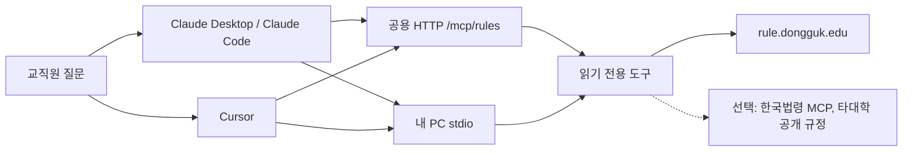

<p align="center">
  
</p>

<p align="center">
  <a href="https://github.com/buenosiempre-cmd/dongguk-rule-mcp/releases/tag/v0.15.8"></a>
  <a href="LICENSE"></a>
  <a href="https://github.com/buenosiempre-cmd/dongguk-rule-mcp/actions/workflows/ci.yml"></a>
</p>

<h1 align="center">동국 규정 MCP</h1>

<p align="center">
  Claude Desktop, Claude Code, Cursor에서 <a href="https://rule.dongguk.edu/">동국대학교 통합규정관리시스템</a>의 규정·조문·별표·개정 이력을 읽는 읽기 전용 MCP 서버입니다.<br>
  <em>Read-only MCP for Dongguk University regulations. Not an official university service.</em>
</p>

> 동국대학교의 공식 서비스가 아닌 개인 운영 도구입니다. 공개 규정 원문(rule.dongguk.edu)을 조회해 전달하며, 최종 판단은 공식 원문과 소관 부서 해석을 따르세요.

공용 주소는 인증 없이 `https://dgu.kr-univ-rules.com/mcp/rules` 입니다. 접속한 IP마다 1분 60회, 하루 1,000회까지 받습니다. npm 레지스트리는 발행하지 않았고, 내 PC 설치는 GitHub 릴리스 v0.15.8 패키지를 사용합니다. 소개 페이지 원본은 [docs/index.html](docs/index.html), 애니메이션 원본은 [docs/assets/usage-demo.html](docs/assets/usage-demo.html), 영상은 [MP4](docs/assets/usage-demo.mp4)입니다.

## 빠른 시작

Node.js는 20.19 이상 20계열, 또는 22.3 이상입니다. Node 21은 제외합니다. CI는 20.19.0, 22, 24에서 `npm test`를 실행합니다.

### 공용 서버

원격 MCP를 지원하는 앱에 주소만 넣습니다. 이 경로는 서버 프로필과 관계없이 공개 규정 도구 15개이며 토큰이 없습니다.

```json
{
  "mcpServers": {
    "dongguk-rule": {
      "url": "https://dgu.kr-univ-rules.com/mcp/rules"
    }
  }
}
```

| 앱 | 넣는 곳 |
|---|---|
| Claude Desktop | `claude_desktop_config.json`의 `mcpServers` |
| Claude Code | 프로젝트 `.mcp.json`, 또는 `claude mcp add --transport http dongguk-rule https://dgu.kr-univ-rules.com/mcp/rules` |
| Cursor | 설정 MCP 또는 `.cursor/mcp.json` |

앱을 완전히 종료한 뒤 다시 실행하고, `get_service_info`로 버전을 확인합니다. 앱·요금제·기관 정책에 따라 원격 MCP 지원이 다를 수 있습니다.

### 내 PC

```bash
npm install -g https://github.com/buenosiempre-cmd/dongguk-rule-mcp/releases/download/v0.15.8/dongguk-rule-mcp-0.15.8.tgz
dongguk-rule-mcp --version
dongguk-rule-mcp --doctor --json
dongguk-rule-mcp --print-config claude
dongguk-rule-mcp --print-config cursor
```

[tgz 직접 받기](https://github.com/buenosiempre-cmd/dongguk-rule-mcp/releases/download/v0.15.8/dongguk-rule-mcp-0.15.8.tgz). `--print-config`는 현재 Node 실행 파일과 설치 경로로 설정을 출력할 뿐, 앱 설정 파일을 수정하지 않습니다. `claude`와 `cursor`는 같은 JSON이고, `codex`는 TOML입니다. Claude Code 로컬 등록 예:

```bash
claude mcp add --transport stdio dongguk-rule -- dongguk-rule-mcp --profile rules
```

출력 JSON의 형태는 아래와 같습니다. `command`는 `node`라는 이름이 아니라 그 PC의 Node 절대 경로입니다.

```json
{
  "mcpServers": {
    "dongguk-rule": {
      "command": "<Node 실행 파일>",
      "args": ["<설치 경로>/src/index.js", "--profile", "rules"]
    }
  }
}
```

설치 권한이 없으면 [구성원 가이드의 prefix 설치](docs/COP_GUIDE.md)를 사용하거나 공용 서버를 씁니다. `--doctor --json`은 오프라인 설치 점검이고, `--doctor --json --live`는 대표 공개 규정 조회를 추가합니다. 진단만으로 모든 원문과 업무 적용이 검증되지는 않습니다.

## 이렇게 물어보세요

아래 답은 서버가 남기는 인용 형식입니다. 금액·전결권자·적용 여부는 표의 행·단위·부칙을 확인하기 전에 확정하지 않습니다. 식별자가 적힌 두 장면은 저장소에 이미 기록된 점검일이며, 오늘 원문과 같다는 뜻이 아닙니다.

### 1. 국내 출장 숙박비

> 서울캠퍼스 직원의 국내 출장 숙박비 기준을 찾아줘. 여비규정의 관련 조문과 별표에서 직급·지역별 행, 금액 단위, 상한, 실비 조건, 주석을 함께 보여줘.

`lookup_dongguk_rule` 예: `{"rule_keyword":"여비규정","query":"국내 출장 숙박비의 상한과 실비 정산 조건","terms":"국내,숙박비,실비,별표","campus":"seoul"}`

2026-11-05 점검에 기록된 조회 형태:

> 「여비규정」 LAW_ID 184, HISTORY_ID 3350, 개정일 2025.04.29. 원문 HWP에 별표 1·2·3이 있습니다.  
> 원문: https://rule.dongguk.edu/lmxsrv/law/lawFullView.srv?SEQ=184&SEQ_HISTORY=3350  
> 별도 첨부 파일 자동 다운로드와 OCR은 없습니다. 금액은 별표의 행·열·단위·주석을 읽은 뒤에만 적습니다.

### 2. 위임전결

> 서울캠퍼스 교비회계 물품 구매의 전결 기준을 위임전결규정에서 찾아줘. 금액 구간과 전결권자는 별표 행이 확인되기 전에는 확정하지 마.

`lookup_dongguk_rule`이 규정명, LAW_ID, HISTORY_ID, 조문 또는 별표 위치, 원문 URL, `evidenceStatus`를 함께 돌려줍니다. `campus`는 업무 맥락만 보존하고 캠퍼스 자동 필터는 없습니다.

### 3. 과거 출장의 기준일

> 2025-03-15 국내 출장 건이야. 당시 여비규정 후보와 현행의 차이를 보고, 개정일과 부칙의 시행일을 구분해줘.

`applicable_rule`에 `{"rule_keyword":"여비규정","date":"2025-03-15","compare_with_current":true}`를 보냅니다. 개정일 이전 후보를 찾을 뿐 시행일·소급 적용을 확정하지 않습니다. 이어서 `compare_rule_versions`로 HWP 조문과 별표·표 셀·그림 파일 해시를 비교합니다.

### 4. 기안문 인용 점검

> 이 비식별 문장의 「여비규정」 제○조(제목) 제○항이 실제 있는지 확인해줘.

`verify_rule_citations`는 규정 실존, 조문 실존, 조문 제목, 항 번호를 대조합니다. 인용이 맞다는 결과와 그 사안에 적용된다는 판단은 다릅니다. 검색 0건은 통과가 아닙니다.

### 5. 겸직을 다른 대학과 나란히

> 겸직 허가의 기간·주체를 동국대와 다른 대학 규정에서 나란히 보여줘. 같은 조항이라고 단정하지 마.

2026-11-24 기록: 동국대는 「전임교원 인사규정 시행세칙」 제37조·제39조·제40조를 주규정으로 골랐고, 다른 사안 조문은 제외했습니다. `compare_university_rules`는 `DONGGUK_UNIVERSITY_COMPARISON_ENABLED=1`일 때만 외부에 요청합니다. 기본은 꺼져 있습니다. 행 순서는 법적 동등성이 아닙니다.

더 많은 업무 질문은 [docs/WORKFLOWS.md](docs/WORKFLOWS.md)에 있습니다.

## 도구

기본 `rules` 프로필과 공용 `/mcp/rules`는 15개입니다. `finance` 프로필은 4개가 더해져 19개입니다. 모두 읽기 전용이며 Markdown과 `structuredContent`를 함께 반환합니다.

| 도구 | 하는 일 |
|---|---|
| `get_service_info` | 버전, 프로필, 도구 수, 이용 안내 |
| `lookup_dongguk_rule` | 기본 조회. 자연어 또는 규정명에서 개정본과 HWP 조문·별표 발췌. `law_id` 직접 선택 |
| `search_rule` | 제목·전문 후보 목록 |
| `get_rule_content` | 알고 있는 LAW_ID의 조·장·키워드 |
| `get_rule_full_text` | 조문·부칙·별표·서식 전문. 긴 문서는 cursor로 이어 받기 |
| `get_rule_toc` | 목차 |
| `list_rule_history` | 개정 이력 |
| `applicable_rule` | 기준일 이전 개정본 후보와 부칙의 명시 시행일 |
| `compare_rule_versions` | HWP 조문 우선 비교, 별표·표 셀·병합·그림 파일 해시 |
| `verify_rule_citations` | 문장의 규정명·조문·제목·항이 있는지 |
| `search_rule_deep` | 여러 규정 전문. 색인이 있으면 색인 사용 |
| `check_rule_updates` | 여러 규정의 개정 여부 |
| `get_rule_references` | 인용한 교내 규정·국가 법령과 역인용. `include_law_text`는 현행 법령 조문 |
| `get_rule_upper_laws` | 인용 법령을 현행 목록과 대조. `include_text`는 규정 조문과 법령 조문을 나란히 |
| `compare_university_rules` | 타대학 조문 비교. 기본 꺼짐. 한 번에 타대학 최대 5곳 |

`finance`에서만 추가되는 도구는 `get_finance_context`, `get_finance_evidence`, `search_finance_handbook`, `review_finance_case`입니다. 내장된 출장비·외부 강사료 공동 조회 외의 재무 카드는 비식별 지식팩 경로가 따로 필요합니다. 내부 자료는 이 저장소에 없습니다.

필드 의미, 잘림 사유, 전문 이어받기, 타대학 어댑터 범위는 [docs/REFERENCE.md](docs/REFERENCE.md)에 이전 README 전문으로 남아 있습니다.

## 동작



stdio가 기본입니다. HTTP는 상태가 없는 Streamable HTTP이고 MCP 경로는 POST입니다. 최신 연혁 캐시는 최대 10분입니다. 공식 API가 아니라 공개 웹 원문을 읽으므로 사이트 변경의 영향을 받습니다. 개인번호, 계좌, 인증정보는 입력하지 않습니다. 신고·지급·결재·외부 발송은 하지 않습니다.

## 자주 묻는 질문

**학교 공식 서비스인가요?**  
아닙니다. 재무팀 개인 운영 도구이며, 최종 해석은 공식 원문과 소관 부서에 있습니다.

**npm으로 설치되나요?**  
아니요. 레지스트리는 미발행입니다. 릴리스 tgz 또는 공용 주소를 사용합니다. 설치 경로가 PC마다 달라 원클릭 딥링크는 두지 않았습니다.

**공용 서버가 멈추면?**  
Mac mini에서 동작하며 잠자기, 전원, 터널, 공식 원문 서버에 영향을 받습니다. 가용성 SLA나 전 구성원 계정 개통을 의미하지 않습니다. `/health`는 프로세스가 요청을 받는지이고, 원문 조회 성공은 아닙니다.

**캠퍼스를 자동으로 거르나요?**  
아니요. 공식 목록의 `LAWGROUP`은 캠퍼스 구분이 아닙니다. 서울·WISE·법인·산학협력단과 교원·직원·학생 적용범위는 원문에서 확인합니다.

**타대학 비교가 바로 되나요?**  
도구는 목록에 있지만 기본은 꺼져 있습니다. 운영자가 `DONGGUK_UNIVERSITY_COMPARISON_ENABLED=1`로 켜야 요청이 나갑니다. 서울대만 law.go.kr OC 키(`DONGGUK_LAWGO_OC`)가 더 필요합니다. 키는 문서와 명령행에 적지 않습니다.

**답을 기안에 바로 써도 되나요?**  
규정명, LAW_ID, HISTORY_ID, 조문 또는 별표, 기준일, 조회일, 원문 URL을 남기고 소관 부서 확인을 거칩니다. `partial`과 검색 0건은 검증 통과가 아닙니다.

## 문서

| 문서 | 내용 |
|---|---|
| [docs/index.html](docs/index.html) | GitHub Pages용 단일 파일 소개 |
| [docs/REFERENCE.md](docs/REFERENCE.md) | 이전 README의 운영·응답 계약 전문 |
| [docs/COP_GUIDE.md](docs/COP_GUIDE.md) | 구성원 시작 |
| [docs/OPERATIONS.md](docs/OPERATIONS.md) | 서버, 토큰, 갱신 |
| [docs/WORKFLOWS.md](docs/WORKFLOWS.md) | 급여·출장·전결·감사·인용 점검 |
| [docs/FINANCE_DESK.md](docs/FINANCE_DESK.md) | finance 프로필과 자료팩 |
| [CHANGELOG.md](CHANGELOG.md) | 변경 기록 |

소스에서 검사하려면 `npm ci` 다음 `npm test`입니다. 실원문은 `npm run test:live`이며 네트워크가 필요합니다. 전교 용량 시험은 아닙니다.

## 기여 · 라이선스

[MIT](LICENSE). 원본 Python 구현은 서준호, Node.js MCP 포팅과 운영은 오승훈입니다. [korean-law-mcp](https://github.com/chrisryugj/korean-law-mcp)에서 영감을 받았습니다. 타대학 포팅 출처는 [docs/THIRD_PARTY.md](docs/THIRD_PARTY.md)입니다.

[Issues](https://github.com/buenosiempre-cmd/dongguk-rule-mcp/issues)에는 버전, 비식별 재현 질문, 오류 코드를 남겨 주세요. 개인정보, 인증값, 내부 문서는 첨부하지 않습니다.
