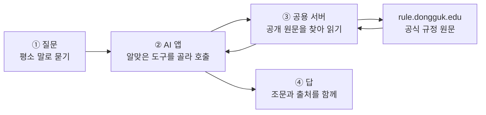

<p align="center">
  <a href="docs/assets/usage-demo.mp4"></a>
  <br><sub>하이라이트(소리 없음)입니다. <a href="docs/assets/usage-demo.mp4"><b>▶ 내레이션이 있는 전체 영상(MP4, 약 1분 30초: 타대학 비교·상위 법령 조회 포함)</b></a> · 앱 화면은 예시이며 화면 속 규정·법령 내용은 공용 서버와 국가법령 실제 조회 결과(2026-11-26)입니다.</sub>
</p>

<p align="center">
  <a href="https://github.com/buenosiempre-cmd/dongguk-rule-mcp/releases/tag/v0.15.8"></a>
  <a href="LICENSE"></a>
  <a href="https://github.com/buenosiempre-cmd/dongguk-rule-mcp/actions/workflows/ci.yml"></a>
</p>

<h1 align="center">동국 규정 MCP</h1>

<p align="center">
  Claude, Cursor, Codex 같은 AI 앱에서 <a href="https://rule.dongguk.edu/">동국대학교 통합규정관리시스템</a>의 규정·조문·별표·개정 이력을 찾아 읽게 해 주는 읽기 전용 MCP 서버입니다.<br>
  <em>Read-only MCP for Dongguk University regulations. Not an official university service.</em>
</p>

> 동국대학교의 공식 서비스가 아닌 개인 운영 도구입니다. 공개 규정 원문(rule.dongguk.edu)을 조회해 전달하며, 최종 판단은 공식 원문과 소관 부서 해석을 따르세요.

## 설치: 주소 하나만 넣으면 됩니다

내 PC에 아무것도 설치하지 않습니다. 쓰는 AI 앱에 아래 공용 서버 주소를 등록하면 끝입니다. 로그인도 토큰도 없습니다.

```text
https://dgu.kr-univ-rules.com/mcp/rules
```

공용 서버에서는 규정 도구 15개가 모두 켜져 있습니다. 접속한 IP마다 1분 60회, 하루 1,000회까지 받습니다.

### Claude Desktop

1. **Customize(사용자 지정) > Connectors(커넥터)** 화면을 엽니다.
2. **+ Add** 를 누르고 **Add custom connector(사용자 지정 커넥터 추가)** 를 고릅니다.
3. 이름은 `동국 규정`, 주소는 위 공용 서버 주소를 넣습니다.
4. Authentication(인증) 항목에서 **No sign in(로그인 없음)** 을 고르고 추가합니다. 이 서버는 인증이 없습니다.
5. 새 대화를 열어 아래 "연결 확인" 문장을 물어봅니다.

화면이 다르면 [Anthropic 공식 안내](https://support.claude.com/en/articles/11175166-get-started-with-custom-connectors-using-remote-mcp)의 현재 절차를 따르세요. 메뉴 이름과 위치는 앱 버전에 따라 다를 수 있습니다. 회사·학교 계정은 관리자가 먼저 커넥터를 추가해야 할 수 있고, 요금제에 따라 추가할 수 있는 커넥터 수가 다릅니다.

### Claude Code

터미널에서 한 줄을 실행합니다.

```bash
claude mcp add --transport http dongguk-rule https://dgu.kr-univ-rules.com/mcp/rules
```

### Cursor

프로젝트의 `.cursor/mcp.json`(모든 프로젝트에 쓰려면 홈 폴더의 `~/.cursor/mcp.json`)에 아래를 넣습니다. 이미 다른 서버가 있으면 `mcpServers` 안에 `dongguk-rule` 항목만 더합니다.

```json
{
  "mcpServers": {
    "dongguk-rule": {
      "url": "https://dgu.kr-univ-rules.com/mcp/rules"
    }
  }
}
```

### Codex

터미널에서 한 줄을 실행합니다.

```bash
codex mcp add dongguk-rule --url https://dgu.kr-univ-rules.com/mcp/rules
```

또는 `~/.codex/config.toml`에 직접 적습니다.

```toml
[mcp_servers.dongguk-rule]
url = "https://dgu.kr-univ-rules.com/mcp/rules"
```

### ChatGPT

ChatGPT에서 사용자 지정 MCP 서버를 등록하는 화면과 조건은 앱 버전, 계정, 워크스페이스 권한에 따라 다릅니다. [OpenAI 공식 안내](https://help.openai.com/en/articles/12584461-connecting-custom-mcp-servers-in-chatgpt)의 현재 절차대로 서버를 추가하고, 주소에 위 공용 서버 주소를 넣습니다. 이 서버는 인증이 없습니다. 안내에 나온 메뉴가 보이지 않으면 앱 버전, 계정 조건, 워크스페이스 관리자의 권한 설정을 확인하세요.

### 연결 확인

앱을 다시 시작한 뒤 이렇게 물어봅니다.

> 동국 규정 MCP가 연결됐는지 확인하고, 여비규정에서 국내 출장 숙박비 기준을 찾아줘.

버전과 도구 수(15)가 나오고, 규정명·조문·원문 링크가 붙은 답이 오면 연결된 것입니다. 원격 MCP 지원 여부는 앱·요금제·기관 정책에 따라 다를 수 있습니다.

### 재무 도구가 필요한 구성원

재무 업무용 도구 4개가 더해진 주소(`https://dgu.kr-univ-rules.com/mcp`)는 구성원 토큰이 있어야 열립니다. 토큰은 운영자(동국대 재무팀 담당자)에게 개별 요청하세요. 받은 토큰은 앱 설정의 인증 헤더(`Authorization: Bearer <발급받은 토큰>`)에만 넣고, 문서·채팅·저장소에는 적지 않습니다.

### 두 번째 선택지: 내 PC에 설치

공용 서버를 쓸 수 없거나 내 PC에서 직접 돌리고 싶을 때만 씁니다. Node.js가 필요합니다(20.19 이상 20계열 또는 22.3 이상, Node 21 제외). npm 레지스트리에는 발행하지 않았고 GitHub 릴리스 패키지로 설치합니다.

```bash
npm install -g https://github.com/buenosiempre-cmd/dongguk-rule-mcp/releases/download/v0.15.8/dongguk-rule-mcp-0.15.8.tgz
dongguk-rule-mcp --version
dongguk-rule-mcp --doctor --json
dongguk-rule-mcp --print-config claude
```

`--print-config` 뒤에는 `claude`, `cursor`, `codex` 중 쓰는 앱을 적습니다. 그 PC의 Node 경로와 설치 경로로 만든 설정을 화면에 보여 줄 뿐이며 앱 설정 파일은 바꾸지 않습니다. 나온 내용을 앱의 MCP 설정에 붙여 넣고 앱을 다시 시작합니다. Claude Code는 한 줄로 등록할 수 있습니다.

```bash
claude mcp add --transport stdio dongguk-rule -- dongguk-rule-mcp --profile rules
```

[tgz 직접 받기](https://github.com/buenosiempre-cmd/dongguk-rule-mcp/releases/download/v0.15.8/dongguk-rule-mcp-0.15.8.tgz). 설치 권한이 없으면 [구성원 가이드의 prefix 설치](docs/COP_GUIDE.md)를 보거나 공용 서버를 씁니다. `--doctor --json`은 설치 점검이고 `--live`를 붙이면 실제 규정 한 건을 조회해 봅니다.

현재 배포본(v0.15.8)을 내 PC에 설치하면 규정 조회 도구는 바로 동작합니다. 타대학 비교와 인용 법령 조회는 앱의 MCP 서버 설정에 아래 환경변수를 넣어야 동작합니다. 넣지 않으면 그 기능만 설정되지 않았다고 답하고, 규정 조회는 그대로 됩니다.

| 기능 | v0.15.8 설치본에 넣을 환경변수 |
|---|---|
| 타대학 비교(`compare_university_rules`) | `DONGGUK_UNIVERSITY_COMPARISON_ENABLED=1`. 서울대까지 보려면 `DONGGUK_LAWGO_OC`(법제처 Open API 인증키)도 필요 |
| 인용 법령의 원문·현행 여부(`get_rule_references`, `get_rule_upper_laws`) | `DONGGUK_LEGAL_MCP_ENABLED=1`, `DONGGUK_PUBLIC_LAW_LINK=1`과 함께, 한국법령 MCP 주소(`DONGGUK_LEGAL_MCP_TRANSPORT=streamable-http`, `DONGGUK_LEGAL_MCP_URL`) 또는 법제처 Open API 인증키(`LAW_OC`, PC에 `korean-law-mcp` 설치 필요) |

법제처 Open API 인증키(OC)는 [open.law.go.kr](https://open.law.go.kr)에서 신청합니다. 공용 서버에는 이 설정이 모두 들어 있어 따로 할 일이 없습니다. 설정이 번거로우면 공용 서버를 쓰세요.

## 어떻게 동작하나요



1. **질문합니다.** "여비규정에서 숙박비 기준 찾아줘"처럼 평소 말로 묻습니다. 도구 이름을 외울 필요는 없습니다.
2. **AI 앱이 도구를 부릅니다.** MCP는 AI 앱이 바깥 자료를 읽을 수 있게 해 주는 연결 방식입니다. 앱이 질문에 맞는 도구를 골라 공용 서버에 요청합니다.
3. **공용 서버가 공식 원문을 읽습니다.** 누구나 볼 수 있는 [rule.dongguk.edu](https://rule.dongguk.edu/)의 공개 원문을 그때그때 조회합니다. 학교 로그인이 필요한 자료나 내부 문서는 읽지 않습니다.
4. **조문과 출처를 붙여 답합니다.** 규정 이름, 조문이나 별표 위치, 개정일, 원문 링크가 함께 옵니다. 링크를 눌러 원문과 대조할 수 있습니다.

읽기만 합니다. 신고·지급·결재·발송은 하지 않습니다. 개인번호, 계좌, 인증정보는 질문에 넣지 마세요. 넣으면 거절합니다. 공식 API가 아니라 공개 웹 원문을 읽기 때문에 사이트가 바뀌면 영향을 받고, 최신 개정 정보는 최대 10분 늦을 수 있습니다.

## 이렇게 물어보세요

아래 답은 서버가 남기는 인용 형식입니다. 금액·전결권자·적용 여부는 표의 행·단위·부칙을 확인하기 전에 확정하지 않습니다. 식별자가 적힌 두 장면은 저장소에 이미 기록된 점검일이며, 오늘 원문과 같다는 뜻이 아닙니다.

### 1. 국내 출장 숙박비

> 서울캠퍼스 직원의 국내 출장 숙박비 기준을 찾아줘. 여비규정의 관련 조문과 별표에서 직급·지역별 행, 금액 단위, 상한, 실비 조건, 주석을 함께 보여줘.

2026-11-05 점검에 기록된 조회 형태:

> 「여비규정」 LAW_ID 184, HISTORY_ID 3350, 개정일 2025.04.29. 원문 HWP에 별표 1·2·3이 있습니다.  
> 원문: https://rule.dongguk.edu/lmxsrv/law/lawFullView.srv?SEQ=184&SEQ_HISTORY=3350  
> 별도 첨부 파일 자동 다운로드와 OCR은 없습니다. 금액은 별표의 행·열·단위·주석을 읽은 뒤에만 적습니다.

### 2. 위임전결

> 서울캠퍼스 교비회계 물품 구매의 전결 기준을 위임전결규정에서 찾아줘. 금액 구간과 전결권자는 별표 행이 확인되기 전에는 확정하지 마.

규정명, 조문 또는 별표 위치, 원문 링크가 함께 옵니다. 캠퍼스는 질문의 맥락으로만 쓰이고 자동으로 걸러 주지는 않습니다.

### 3. 과거 출장의 기준일

> 2025-03-15 국내 출장 건이야. 당시 여비규정 후보와 현행의 차이를 보고, 개정일과 부칙의 시행일을 구분해줘.

그 날짜 이전의 개정본 후보를 찾고 현행과 달라진 조문·별표를 비교합니다. 시행일과 소급 적용까지 확정해 주지는 않습니다.

### 4. 기안문 인용 점검

> 이 비식별 문장의 「여비규정」 제○조(제목) 제○항이 실제 있는지 확인해줘.

규정, 조문, 조문 제목, 항 번호가 실제 있는지 대조합니다. 인용이 맞다는 결과와 그 사안에 적용된다는 판단은 다릅니다. 검색 0건은 통과가 아닙니다.

### 5. 겸직을 다른 대학과 나란히

> 겸직 허가의 기간·주체를 동국대와 다른 대학 규정에서 나란히 보여줘. 같은 조항이라고 단정하지 마.

2026-11-24 기록: 동국대는 「전임교원 인사규정 시행세칙」 제37조·제39조·제40조를 주규정으로 골랐고, 다른 사안 조문은 제외했습니다. 행 순서는 법적 동등성이 아닙니다.

더 많은 업무 질문과 도구 입력 예시는 [docs/WORKFLOWS.md](docs/WORKFLOWS.md)에 있습니다.

## 도구가 하는 일

도구는 AI 앱이 알아서 고릅니다. 아래 표는 "이런 것도 물어볼 수 있구나" 하고 보는 용도입니다. 15개 모두 읽기 전용이고 공용 서버에서 모두 켜져 있습니다.

| 도구 | 하는 일 | 이렇게 물으면 씁니다 |
|---|---|---|
| `lookup_dongguk_rule` | 질문에 맞는 규정을 찾아 관련 조문과 별표를 보여 줍니다. 대부분의 질문은 여기서 시작합니다 | 여비규정에서 국내 출장 숙박비 기준 찾아줘 |
| `search_rule` | 규정 이름이나 내용으로 후보 목록을 보여 줍니다 | 장학금과 관련된 규정이 뭐가 있어? |
| `get_rule_content` | 이미 고른 규정에서 특정 조나 장을 보여 줍니다 | 여비규정 제5조 보여줘 |
| `get_rule_full_text` | 규정 하나를 부칙·별표·서식까지 처음부터 끝까지 보여 줍니다. 긴 규정은 여러 번에 나누어 가져옵니다 | 위임전결규정 전문을 보여줘 |
| `get_rule_toc` | 규정의 목차를 보여 줍니다 | 학칙 목차 보여줘 |
| `list_rule_history` | 규정이 언제 개정됐는지 이력을 보여 줍니다 | 여비규정이 언제 개정됐어? |
| `applicable_rule` | 특정 날짜 기준으로 어느 개정본이 후보인지 찾습니다 | 2025년 3월 15일 출장에는 어느 여비규정을 봐야 해? |
| `compare_rule_versions` | 두 개정본을 비교해 바뀐 조문과 별표를 보여 줍니다 | 여비규정이 직전 개정에서 뭐가 달라졌어? |
| `verify_rule_citations` | 문장에 적은 규정명과 조문이 실제로 있는지 확인합니다 | 이 기안문에 인용한 조문이 실제 있는지 확인해줘 |
| `search_rule_deep` | 여러 규정의 본문을 한꺼번에 검색합니다 | '겸직'이 나오는 규정을 모두 찾아줘 |
| `check_rule_updates` | 여러 규정이 기준일 이후 개정됐는지 한 번에 점검합니다 | 여비규정과 위임전결규정이 지난달 이후 개정됐어? |
| `get_rule_references` | 규정이 인용한 다른 교내 규정·국가 법령과, 이 규정을 인용한 규정을 찾습니다. 인용한 법령 조문의 원문도 가져올 수 있습니다 | 여비규정이 인용하는 법령과 그 조문을 보여줘 |
| `get_rule_upper_laws` | 규정이 근거로 든 법령이 지금도 그대로인지(현행·삭제·개정) 점검합니다 | 이 규정이 근거로 든 법령이 바뀌었는지 봐줘 |
| `compare_university_rules` | 같은 주제의 조문을 다른 대학(한 번에 최대 5곳) 규정과 나란히 보여 줍니다 | 겸직 허가 기준을 고려대·연세대와 나란히 보여줘 |
| `get_service_info` | 연결 상태, 버전, 켜진 기능을 알려 줍니다 | 동국 규정 MCP 연결됐는지 확인해줘 |

비교·점검 도구는 "다시 볼 곳"을 알려 줄 뿐이고, 같은 내용인지·적용되는지는 판정하지 않습니다.

구성원 토큰으로 여는 재무용 주소에서는 `get_finance_context`, `get_finance_evidence`, `search_finance_handbook`, `review_finance_case` 4개가 더해져 19개입니다. 내부 자료는 이 저장소에 없습니다.

개발자용 입력 인수, 응답 필드, 잘림 사유, 긴 전문을 이어 받는 방법은 [docs/REFERENCE.md](docs/REFERENCE.md)에 있습니다.

## 자주 묻는 질문

**학교 공식 서비스인가요?**  
아닙니다. 재무팀 개인 운영 도구이며, 최종 해석은 공식 원문과 소관 부서에 있습니다.

**돈이 드나요? 가입해야 하나요?**  
공용 서버 주소는 가입·로그인 없이 씁니다. AI 앱 자체의 요금제는 각 앱의 정책을 따릅니다.

**npm으로 설치되나요?**  
아니요. 레지스트리는 미발행입니다. 공용 서버 주소를 쓰거나 릴리스 tgz로 설치합니다.

**공용 서버가 멈추면?**  
공용 서버는 개인이 운영하는 장비 한 대에서 돌아가며 전원, 네트워크, 공식 원문 서버 상태에 영향을 받습니다. 상시 가용성을 약속하지 않습니다. 멈췄을 때는 [공식 규정 시스템](https://rule.dongguk.edu/)을 직접 보거나 내 PC 설치를 씁니다.

**캠퍼스를 자동으로 거르나요?**  
아니요. 서울·WISE·법인·산학협력단과 교원·직원·학생 적용범위는 원문에서 확인합니다.

**타대학 비교가 바로 되나요?**  
공용 서버에서는 바로 됩니다. 내 PC에 v0.15.8을 설치했다면 `DONGGUK_UNIVERSITY_COMPARISON_ENABLED=1`을 넣어야 하고, 서울대는 법제처 Open API 인증키(`DONGGUK_LAWGO_OC`)가 더 필요합니다. 공개된 규정만 읽으며 법적 동등성을 판정하지 않습니다.

**답을 기안에 바로 써도 되나요?**  
규정명, 조문 또는 별표, 기준일, 조회일, 원문 링크를 남기고 소관 부서 확인을 거칩니다. 일부만 조회됐다는 표시와 검색 0건은 검증 통과가 아닙니다.

## 문서

| 문서 | 내용 |
|---|---|
| [docs/index.html](docs/index.html) | GitHub Pages용 단일 파일 소개 |
| [docs/REFERENCE.md](docs/REFERENCE.md) | 개발자용 인수·응답 필드·설정·운영 참고 |
| [docs/COP_GUIDE.md](docs/COP_GUIDE.md) | 구성원 시작 |
| [docs/OPERATIONS.md](docs/OPERATIONS.md) | 서버, 토큰, 갱신 |
| [docs/WORKFLOWS.md](docs/WORKFLOWS.md) | 급여·출장·전결·감사·인용 점검 |
| [docs/FINANCE_DESK.md](docs/FINANCE_DESK.md) | finance 프로필과 자료팩 |
| [CHANGELOG.md](CHANGELOG.md) | 변경 기록 |

소개 영상 원본은 [docs/assets/intro/intro.html](docs/assets/intro/intro.html)(대본 [narration.json](docs/assets/intro/narration.json), 화면 속 내용은 `lookup_dongguk_rule`·`compare_university_rules`·`get_rule_upper_laws` 응답), 앱 예시 화면 원본은 [docs/assets/usage-demo.html](docs/assets/usage-demo.html)입니다. `python3 scripts/intro-video/narrate.py`(MeloTTS로 내레이션 합성, `--only c1,c2`처럼 일부 줄만 다시 합성 가능) 다음 `node scripts/intro-video/record.cjs`로 [MP4](docs/assets/usage-demo.mp4)와 하이라이트 GIF를 다시 만듭니다(크롬·ffmpeg·numpy 필요). 내레이션은 MIT 라이선스인 MeloTTS로 합성했고 배경음은 스크립트가 직접 합성해 외부 음원이 없습니다. 버전·라이선스 배지는 외부 배지 서버 장애에 영향받지 않도록 [docs/assets/badges](docs/assets/badges)의 SVG를 씁니다. 릴리스 때 version.svg의 버전 글자도 함께 바꿉니다. 소스에서 검사하려면 `npm ci` 다음 `npm test`입니다. CI는 Node 20.19.0, 22, 24에서 실행합니다. 실원문은 `npm run test:live`이며 네트워크가 필요합니다. 전교 용량 시험은 아닙니다.

## 기여 · 라이선스

[MIT](LICENSE). 원본 Python 구현은 서준호, Node.js MCP 포팅과 운영은 오승훈입니다. [korean-law-mcp](https://github.com/chrisryugj/korean-law-mcp)에서 영감을 받았습니다. 타대학 포팅 출처는 [docs/THIRD_PARTY.md](docs/THIRD_PARTY.md)입니다.

[Issues](https://github.com/buenosiempre-cmd/dongguk-rule-mcp/issues)에는 버전, 비식별 재현 질문, 오류 코드를 남겨 주세요. 개인정보, 인증값, 내부 문서는 첨부하지 않습니다.
